# DeskSlot — complete application specification

Version: 0.1 · View: TARGET · Status: READY_FOR_REVIEW

This is an authored worked example for the package, not an implemented app.
All design choices are proposals for demonstration. Application execution and
tests are NOT_RUN. Paths below are implementation outputs to create; this document
defines their contracts inline and does not claim those future files already exist.

## 1. Purpose and scope — S01

Office members can find a free desk for an interval, reserve it, see their own
reservations and cancel an upcoming reservation. Success means a member can
finish that flow and the same desk cannot have overlapping active reservations.

This release serves one office with seeded members/desks. It includes login,
availability, booking, cancellation and an audit trail. Registration, payments,
email, administration UI, recurring reservations and external providers are
outside scope. All screen inputs and displays explicitly use UTC in this example.

Policies S01–S11, S13–S15 and S18 are included. S12 is omitted because no provider
or background job exists; S16 because this is greenfield; S17 because company
operations are not the subject. There are no unresolved design options in the
worked example, but these proposals require review before product implementation.

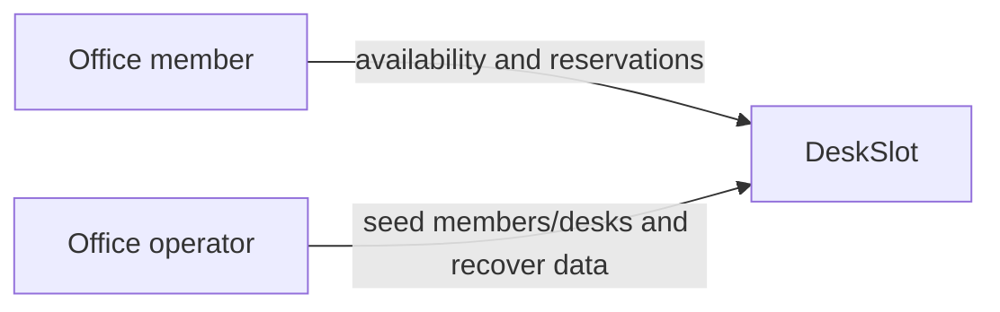

DG-SCOPE · TARGET · context adaptation. Member is the product actor; Operator
uses deployment/seed commands, not an admin screen. Scope is the four booking
tasks above plus authentication and operations support.

## 2. Functions — S02

| ID | Function | Inputs → outputs | Controls | Mechanisms / contracts |
|---|---|---|---|---|
| F-AUTH | Authenticate member | credentials → cookie/current member | active membership, session expiration | UI-LOGIN, OP-LOGIN/ME/LOGOUT, H-AUTH, D-SESSION, AC-01/07 |
| F-AVAIL | Browse availability | interval → desks with availability | R-TIME | UI-AVAIL, OP-DESKS, H-AVAIL, D-DESK/D-RES, AC-02 |
| F-CREATE | Create reservation | desk and interval → persisted reservation | R-ACTIVE/R-TIME/R-OVERLAP | UI-AVAIL, OP-CREATE, H-CREATE, D-RES/D-AUDIT, AC-03/04/08 |
| F-MINE | List own reservations | page → own reservation list | R-OWNER | UI-MINE, OP-MINE, H-MINE, D-RES, AC-05 |
| F-CANCEL | Cancel reservation | reservation ID → cancelled reservation | R-OWNER/R-CANCEL | UI-MINE, OP-CANCEL, H-CANCEL, D-RES/D-AUDIT, AC-06 |

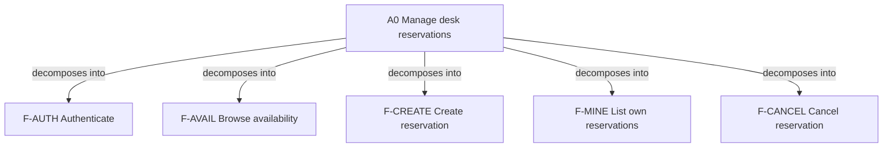

DG-FUNCTIONS · IDEF0-inspired hierarchy; edges mean decomposition. The function
table supplies ICOM and leaf contracts; this is not formal IDEF0 or execution order.

## 3. Domain and information — S04

- **D-MEMBER**: a seeded office account. Identity is a UUID. Email is canonicalized
  to lowercase before storage/login; active=false denies protected operations.
- **D-DESK**: a seeded physical desk with UUID and unique label. No runtime delete
  or deactivate API exists in this release.
- **D-RES**: a reservation owned by one member for one desk and the half-open
  interval `[starts_at, ends_at)`. Status is `ACTIVE` or `CANCELLED`; records remain.
- **D-SESSION**: a server-side authentication session, unrelated to reservation status.
- **D-AUDIT**: an append-only create/cancel event in the same transaction as its change.

Timestamps enter as RFC3339 with an explicit offset, normalize to UTC and return
with `Z`. Booking input must be on 15-minute boundaries. Duration is 15–120 minutes.
Start must be later than the server's current time and no more than 30 days ahead.
Adjacent intervals are allowed; overlapping active intervals are not. Historical
reservation end time does not change its stored status automatically.

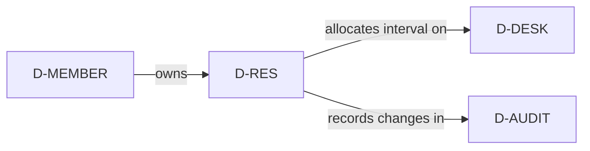

DG-DOMAIN · concept adaptation. The relations above define meaning; the physical
keys and cardinalities are supplied in section 9.

## 4. Scenarios — S03

**SC-01 Sign in**: member enters email/password. Valid active credentials create
a session and open availability. Invalid credentials return the same login error;
the password is cleared. An expired session returns the user to login.

**SC-02 Browse**: member selects a UTC interval, requests availability and sees all
desks ordered by label with available/unavailable state. This is a snapshot; a
desk can become unavailable before creation.

**SC-03 Book**: member selects a desk and submits the current interval. On 201 show
confirmation and refresh availability/my reservations. On 409 keep interval and
selection, explain the conflict and refresh availability. On an uncertain network
outcome refresh the member's list before offering another submission.

**SC-04 My reservations**: member opens their paginated list, newest start time first.
Show all retained statuses; other members' reservations are never returned.

**SC-05 Cancel**: owner cancels an ACTIVE future reservation. Commit status and audit
together, then replace the row on screen. Repeating cancellation of an already
CANCELLED owned reservation returns the same result with no extra audit event.
An ACTIVE reservation already started returns 409; a foreign/nonexistent ID returns 404.

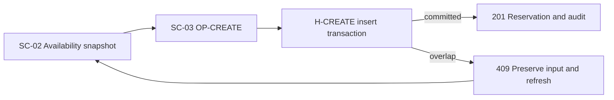

DG-PROCESS · process adaptation. The flow binds SC-02/03 to H-CREATE and the
D-RES exclusion constraint; it does not promise availability remains stable.

## 5. Architecture and files — S05

Chosen demonstration stack: React/TypeScript SPA with Vite; Python 3.12/FastAPI,
Pydantic 2 and SQLAlchemy 2; Alembic; PostgreSQL 16. Use current compatible patch
versions and commit lockfiles when implementing. Exact library patches are a
dependency-resolution task, not an already executed installation claim.

| Component | Responsibility | Planned files |
|---|---|---|
| C-WEB | Three routes, typed API client, form/list state | `web/src/routes/{Login,Availability,MyReservations}.tsx`, `web/src/components/{IntervalForm,DeskCard,ReservationRow}.tsx`, `web/src/api.ts`, `web/src/contracts.ts` |
| C-API | Wire validation, auth, handlers, error normalization | `api/app/main.py`, `api/app/routes/{auth,desks,reservations}.py`, `api/app/contracts.py`, `api/app/errors.py` |
| C-SERVICE | Booking algorithms and repository calls | `api/app/services/{auth,reservations}.py`, `api/app/repositories/{members,reservations,sessions}.py` |
| C-DATA | SQLAlchemy mappings and migrations for section 9 | `api/app/models.py`, `api/migrations/versions/0001_initial.py` |
| C-OPS | Reproducible run, seed, health and restore | `compose.yaml`, `api/Dockerfile`, `web/Dockerfile`, `api/app/seed.py`, `ops/Caddyfile` |

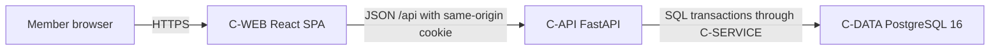

DG-ARCHITECTURE · container adaptation. C-SERVICE runs inside C-API; its internal
responsibilities appear in DG-HANDLERS. Web calls API only; the browser has no
database access. See DG-DEPLOYMENT for separately running processes.

## 6. Screens and interaction — S06

**UI-LOGIN `/login`**: centered form, labeled email/password, submit action and
one error area. Submit OP-LOGIN; disable repeated submit while pending. 200 routes
to `/availability`; 401 clears password and shows “Email or password is incorrect”.
429 uses Retry-After; network/503 keeps email and permits retry. Never log credentials.

**UI-AVAIL `/availability`**: header with My reservations and Sign out; interval
form above a desk grid. Form uses `datetime-local` inputs explicitly labeled UTC,
step=900 seconds. Interpret values as UTC, not the browser's local time zone.
Client validation mirrors R-TIME for feedback; server validation remains authoritative.
Apply calls OP-DESKS. Each card shows desk label, availability and Reserve action.
Reserve submits OP-CREATE with the displayed interval. Before the first lookup
show an instruction; pending lookup shows a loading state; no desks shows an empty
state. Failed refresh retains prior results labeled stale and disables Reserve.
409 preserves inputs and refreshes results. A server422 displays the interval
validation message and asks for a new valid interval without discarding the form.
Success announces completion and offers
a link to `/mine`. Timeout prompts checking `/mine` before another attempt.

**UI-MINE `/mine`**: table/list of desk label, UTC interval, status and Cancel.
Use OP-MINE with page=1,page_size=20; previous/next use response total. A loading
state retains prior rows; an empty list explains how to reserve. Cancel appears
for ACTIVE future rows, submits OP-CANCEL and replaces the returned row. Reaching
the start time hides the action based on server time; server guards remain authoritative.
409 explains the timing conflict and refreshes; 404 refreshes the list.

Shared frontend contract: OP-ME runs on startup; 401 clears local member state and
routes to login; 403 announces inactive account and routes to login. API calls use
same-origin credentials and the error envelope from section 7. Non-JSON network
failures become a distinct transport error, not a fabricated server status.

Concrete design for this example: system font, white page, dark text, blue primary
action, max-width 1120px, 16px body text, 24px main padding, 8px spacing unit.
Desk grid: one column below 640px, two below 960px, three above. At narrow widths
reservations are stacked labeled rows. Buttons have visible focus and >=44px
touch height; inputs have associated labels; loading/success uses polite live
announcements, errors use a focusable alert. Status includes text, not color alone.

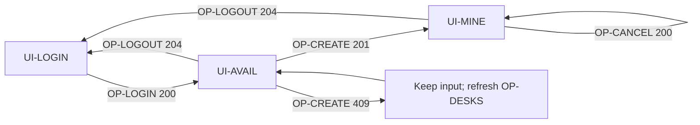

DG-INTERACTION · IDEF8-inspired action-response adaptation. Bind all routes and
responses to the screen records; successful creation can remain on availability
with a confirmation/link, so the 201 edge represents the offered My reservations journey.

## 7. Wire contracts — S07

This section owns wire fields. Generate OpenAPI from these Pydantic models during
implementation, and use it to check the TypeScript client. Reject unknown write
fields; owner IDs, status and created timestamps are server-owned.

`Member = {id: UUID, email: string, name: string}`.
`Reservation = {id: UUID, desk_id: UUID, desk_label: string, starts_at: RFC3339,
ends_at: RFC3339, status: ACTIVE|CANCELLED, created_at: RFC3339,
cancelled_at: RFC3339|null}`. No password/token/hash fields are returned.

Error: `{"error":{"code":"RESERVATION_CONFLICT","message":"Desk is no longer available","request_id":"UUID"}}`.
Generate request_id server-side and return `X-Request-Id` on all responses.
400 means malformed JSON; 422 means a malformed/invalid field; 503 means storage
is unavailable. Log request ID/code without credentials/session tokens.

| OP ID | Method/path and auth | Request | Success | Specific errors |
|---|---|---|---|---|
| OP-LOGIN | POST `/api/login`, public, allowed Origin | `{email: valid email <=254 chars, password: string 1..1024}` | 200 Member, Set-Cookie | 401 INVALID_CREDENTIALS; 429 LOGIN_RATE_LIMIT |
| OP-ME | GET `/api/me`, session | none | 200 Member, `X-Server-Time` RFC3339 | 401 UNAUTHENTICATED; 403 MEMBER_INACTIVE |
| OP-LOGOUT | POST `/api/logout`, allowed Origin | none | 204, clear cookie, revoke session if present | 403 ORIGIN_DENIED |
| OP-DESKS | GET `/api/desks`, active member | required query starts_at/ends_at satisfying R-TIME | 200 `{items:[{id:UUID,label:string,available:boolean}],starts_at,ends_at}` | 422 INVALID_INTERVAL |
| OP-CREATE | POST `/api/reservations`, active member, allowed Origin | `{desk_id:UUID, starts_at:RFC3339, ends_at:RFC3339}` satisfying R-TIME | 201 Reservation, Location `/api/reservations/{id}` | 404 DESK_NOT_FOUND; 409 RESERVATION_CONFLICT; 422 INVALID_INTERVAL |
| OP-GET | GET `/api/reservations/{id}`, active owner | path UUID | 200 Reservation | 404 RESERVATION_NOT_FOUND, also for foreign ownership |
| OP-MINE | GET `/api/reservations`, active member | page integer >=1 default1; page_size integer1..100 default20 | 200 `{items:Reservation[],page,page_size,total}` | 422 INVALID_PAGE |
| OP-CANCEL | POST `/api/reservations/{id}/cancel`, active owner, allowed Origin | UUID path; no body | 200 Reservation, already cancelled included | 404 RESERVATION_NOT_FOUND; 409 CANCELLATION_CLOSED |
| OP-HEALTH | GET `/api/health`, public | none | 200 `{status:"ok"}` after DB probe | 503 `{status:"unavailable"}` |

Protected operations share 401/403 authentication errors. Mutating requests,
including login, require Origin equal to BASE_ORIGIN; missing/mismatched Origin
returns 403 ORIGIN_DENIED. Non-browser scripts must supply that header. Reject
unsupported content types for JSON writes with 415 UNSUPPORTED_MEDIA_TYPE.

Create example request: `{"desk_id":"20000000-0000-4000-8000-000000000001","starts_at":"2026-10-12T09:00:00Z","ends_at":"2026-10-12T10:00:00Z"}`.
Use an injected server clock before that start for a fixture; do not make this
dated example a permanent valid production input.

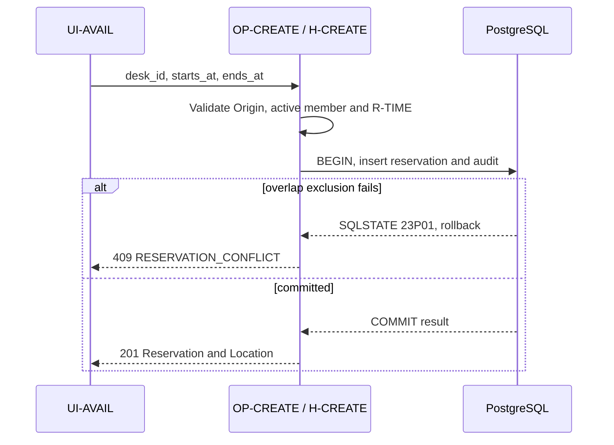

DG-API · boundary sequence. Only a committed reservation produces 201; a conflict
leaves neither its reservation nor audit record. Full field definitions remain above.

## 8. Handlers and algorithms — S08

Use Pydantic request/result models and aware UTC datetimes. `CurrentMember` is
derived from the session, never from a write payload. Repositories receive the
transaction-scoped SQLAlchemy Session; services do not silently start extra commits.

| H ID / planned service signature | Algorithm and dependencies |
|---|---|
| H-AUTH `login(input: LoginInput, now: datetime) -> Member` | Enforce Origin/throttle; canonicalize email; verify Argon2id (dummy verification for unknown email); require active member; create random session token, store hash/expiry; commit; set cookie; return Member |
| H-ME `current_member(cookie: str, now: datetime) -> CurrentMember` | Hash token, find unexpired session and active member; reject missing/expired token with401, inactive member with403; return Member plus server time |
| H-LOGOUT `logout(cookie: str|None) -> None` | Enforce Origin; delete matching session if present and commit; always clear cookie and return204 |
| H-AVAIL `availability(interval: IntervalInput, member: CurrentMember) -> Availability` | Validate R-TIME; select all desks with NOT EXISTS active overlapping reservation; order label ascending; return snapshot |
| H-CREATE `create_reservation(input: CreateReservation, member: CurrentMember, now: datetime) -> Reservation` | Validate R-TIME and desk existence; generate UUID; in one transaction insert ACTIVE reservation and CREATE audit; commit; map only named overlap constraint/23P01 to409; return row joined with desk label |
| H-GET `get_reservation(id: UUID, member: CurrentMember) -> Reservation` | Query by both id and member_id, join desk; return404 if absent |
| H-MINE `list_reservations(page: int, page_size: int, member: CurrentMember) -> Page` | Filter by member_id; order starts_at descending,id descending; count and page in one repeatable-read snapshot; join desk labels |
| H-CANCEL `cancel_reservation(id: UUID, member: CurrentMember, now: datetime) -> Reservation` | Lock owned reservation FOR UPDATE; absent404; CANCELLED returns unchanged even after start; otherwise require starts_at>now; update status/cancelled_at and insert CANCEL audit together; commit and return row |
| H-HEALTH `probe_db() -> Health` in main.py | Run a DB probe with a 2-second budget; report200 ok or503 unavailable without exposing connection details |

Capture `now` at handler entry. Database failures roll back; unexpected failures
are logged by request ID and return500 INTERNAL_ERROR. A committed response lost
to the network cannot be undone. Creation has no Idempotency-Key in this release:
replay of the same interval finds its existing active reservation and returns409.
The UI must inspect OP-MINE after an uncertain outcome instead of blind retry.

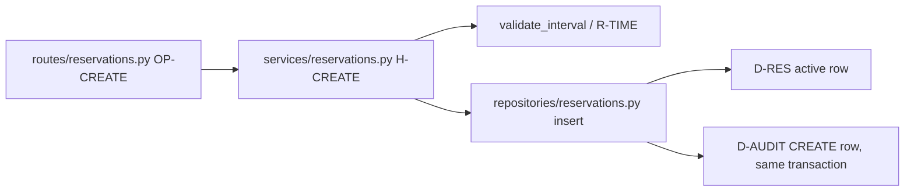

DG-HANDLERS · IDEF4-inspired call/dependency view. The algorithm table defines
order; graph edges identify calls and owning data contracts.

## 9. Physical schema and migrations — S09

The following DDL is the physical contract to reproduce in migration 0001.
UUIDs are generated by the application. Do not add `now()`-based CHECK constraints:
future/start-time behavior is evaluated by the handler using its captured clock.

```sql
CREATE EXTENSION IF NOT EXISTS btree_gist;

CREATE TABLE members (
  id uuid PRIMARY KEY,
  email varchar(254) NOT NULL UNIQUE CHECK (email = lower(email)),
  name varchar(80) NOT NULL CHECK (length(trim(name)) > 0),
  password_hash varchar(255) NOT NULL,
  active boolean NOT NULL DEFAULT true
);

CREATE TABLE desks (
  id uuid PRIMARY KEY,
  label varchar(40) NOT NULL UNIQUE CHECK (length(trim(label)) > 0)
);

CREATE TABLE sessions (
  token_hash char(64) PRIMARY KEY,
  member_id uuid NOT NULL REFERENCES members(id) ON DELETE CASCADE,
  created_at timestamptz NOT NULL,
  expires_at timestamptz NOT NULL CHECK (expires_at > created_at)
);
CREATE INDEX sessions_member_idx ON sessions(member_id);
CREATE INDEX sessions_expiry_idx ON sessions(expires_at);

CREATE TABLE reservations (
  id uuid PRIMARY KEY,
  desk_id uuid NOT NULL REFERENCES desks(id) ON DELETE RESTRICT,
  member_id uuid NOT NULL REFERENCES members(id) ON DELETE RESTRICT,
  starts_at timestamptz NOT NULL,
  ends_at timestamptz NOT NULL,
  status text NOT NULL CHECK (status IN ('ACTIVE', 'CANCELLED')),
  created_at timestamptz NOT NULL,
  cancelled_at timestamptz,
  CONSTRAINT finite_interval CHECK (isfinite(starts_at) AND isfinite(ends_at)),
  CONSTRAINT valid_duration CHECK (
    ends_at > starts_at AND ends_at - starts_at <= interval '120 minutes'
  ),
  CONSTRAINT fifteen_minute_boundaries CHECK (
    mod(extract(epoch FROM starts_at), 900) = 0
    AND mod(extract(epoch FROM ends_at), 900) = 0
  ),
  CONSTRAINT cancellation_consistency CHECK (
    (status = 'ACTIVE' AND cancelled_at IS NULL)
    OR (status = 'CANCELLED' AND cancelled_at IS NOT NULL)
  ),
  CONSTRAINT no_active_desk_overlap EXCLUDE USING gist (
    desk_id WITH =,
    tstzrange(starts_at, ends_at, '[)') WITH &&
  ) WHERE (status = 'ACTIVE')
);
CREATE INDEX reservations_owner_start_idx
  ON reservations(member_id, starts_at DESC, id DESC);

CREATE TABLE reservation_audit (
  id uuid PRIMARY KEY,
  reservation_id uuid NOT NULL REFERENCES reservations(id) ON DELETE RESTRICT,
  actor_id uuid NOT NULL REFERENCES members(id) ON DELETE RESTRICT,
  event_type text NOT NULL CHECK (event_type IN ('CREATE', 'CANCEL')),
  occurred_at timestamptz NOT NULL,
  UNIQUE (reservation_id, event_type)
);
```

D-RES's exclusion constraint is the authority for concurrent overlap, rather
than an availability pre-check. PostgreSQL range exclusion plus `btree_gist`
supports this combination of UUID equality and timestamp overlap.
[Range constraints](https://www.postgresql.org/docs/16/rangetypes.html#RANGETYPES-CONSTRAINT),
[btree_gist](https://www.postgresql.org/docs/16/btree-gist.html).

Availability query per desk is `NOT EXISTS` over ACTIVE reservations for that desk
whose `tstzrange(starts_at,ends_at,'[)')` overlaps the requested range. OP-MINE uses
the owner/start index and a repeatable-read snapshot for its count and page.
The exclusion index also serves the overlap predicate. Review plans with the
quality fixture; this statement is a design, not measured query performance.

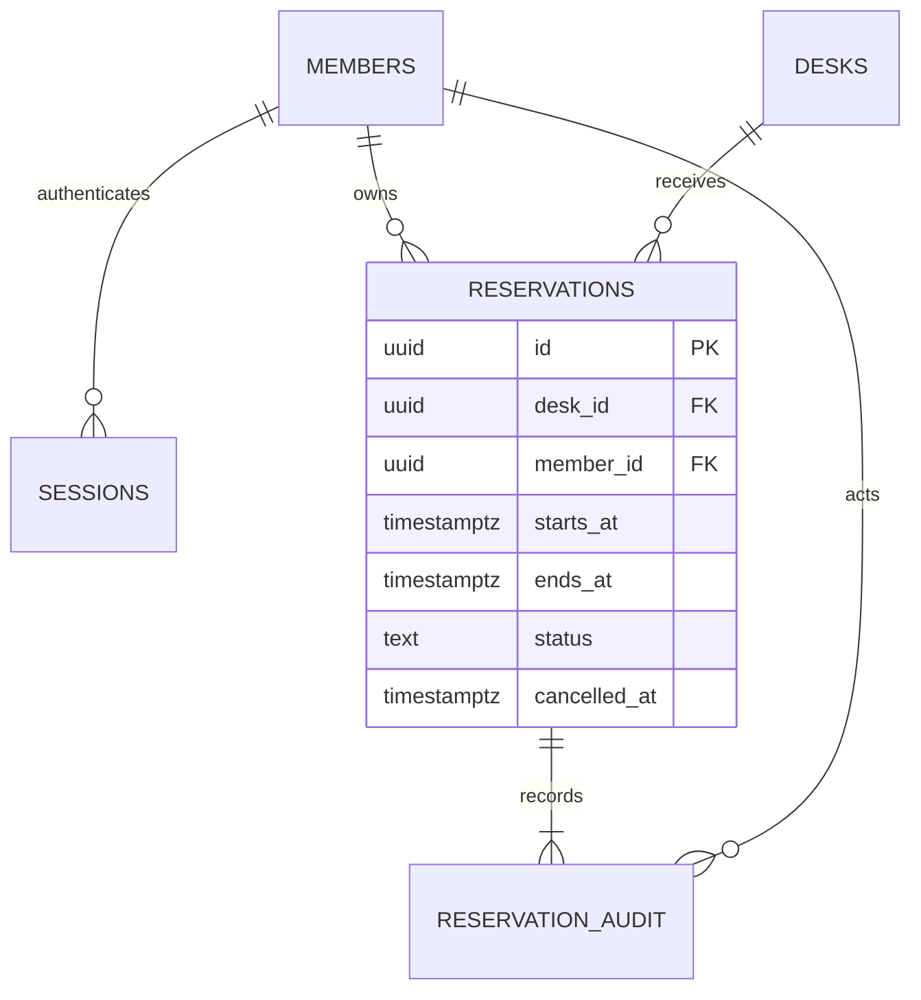

DG-DATA · ER adaptation, not formal IDEF1X. Each reservation has one member and
desk, with at least one committed CREATE audit by H-CREATE. The audit minimum
is a transaction contract, not a reverse FK guarantee in the DDL.

No runtime purge/delete feature exists. Retain reservation/audit records and
backups for the office's configured operational lifetime in this release. A
future retention change must define its business policy and migration explicitly.
Expired sessions can remain stored but cannot authenticate; seed/maintenance CLI
`python -m app.seed --clean-expired-sessions` deletes them without touching reservations.

## 10. Rules, authentication and trust — S10

| Rule | Condition / result | Enforcement | Acceptance |
|---|---|---|---|
| R-ACTIVE | Protected operations require an active member and unexpired session | H-ME dependency on every protected route | AC-01/07 |
| R-TIME | Aware finite timestamps, 15-minute boundaries, 15–120-minute duration, future start <=30 days | Pydantic validation + shared validate_interval; DDL duration/boundaries | AC-02/08 |
| R-OVERLAP | Same desk's ACTIVE intervals cannot overlap; adjacency allowed | D-RES no_active_desk_overlap, mapped to409 by H-CREATE | AC-04 |
| R-OWNER | List/read/cancel exposes only current member's reservations | owner-filtered H-MINE/H-GET/H-CANCEL, foreign ID404 | AC-05/06 |
| R-CANCEL | An ACTIVE reservation may be cancelled only before starts_at | H-CANCEL under row lock; cancelled repeat returns unchanged | AC-06 |
| R-ORIGIN | Writes accept only exact BASE_ORIGIN | route middleware/dependency; 403 before mutation | AC-07 |

H-AUTH uses Argon2id, 64MiB memory, 3 iterations, parallelism1 and a random salt
per password. Seed passwords come from environment; never commit/log them.
Session tokens contain 32 random bytes, encoded base64url; store only their SHA-256
hex digest. Expiration is 8 hours after creation, with no sliding extension.
Cookie `desk_session` is HttpOnly, SameSite=Lax, Path=/, no Domain, Max-Age=28800;
Secure=true outside explicitly configured loopback development. Logout revokes the
record and expires the cookie. No token is stored in localStorage or returned in JSON.
These are our concrete example choices informed by
[password storage](https://cheatsheetseries.owasp.org/cheatsheets/Password_Storage_Cheat_Sheet.html)
and [session management](https://cheatsheetseries.owasp.org/cheatsheets/Session_Management_Cheat_Sheet.html).

Limit login to 5 attempts per source IP per rolling 60 seconds; request6 returns429
with Retry-After equal to remaining window seconds rounded up. The API runs one
worker in this release, so the in-memory limiter is process-local and resets on
restart. Trust proxy client-IP headers only from the private web proxy. Horizontal
scaling would require revisiting this mechanism. Parameterize all SQL operations;
do not expose internal exception text or credentials in response/logs.

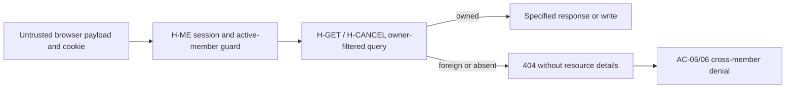

DG-RULES · trust/enforcement adaptation. The browser cannot choose member_id;
ownership is derived server-side. Its ID/count details never enter a foreign response.

## 11. Lifecycle and competing requests — S11

| Transition | Guard | Durable change / repeat |
|---|---|---|
| absent → ACTIVE | H-CREATE auth/time/desk checks and overlap constraint | reservation + CREATE audit committed together |
| ACTIVE → CANCELLED | same owner and captured now < starts_at | row lock, status/cancelled_at + CANCEL audit in one commit |
| CANCELLED → CANCELLED | same owner | return200 unchanged, no new audit; permitted after starts_at |
| ACTIVE → ACTIVE on cancelled request after start | guard fails | 409, no write |

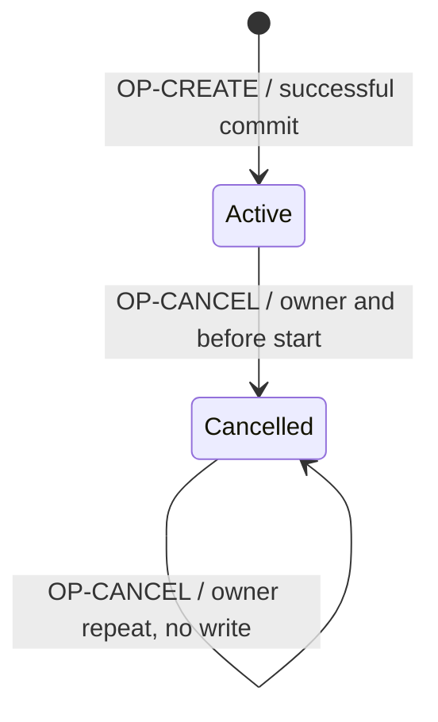

DG-STATE · state adaptation bound to D-RES.status and H-CREATE/H-CANCEL. Passing
time alone does not add a COMPLETED state. Row deletion is not a transition.

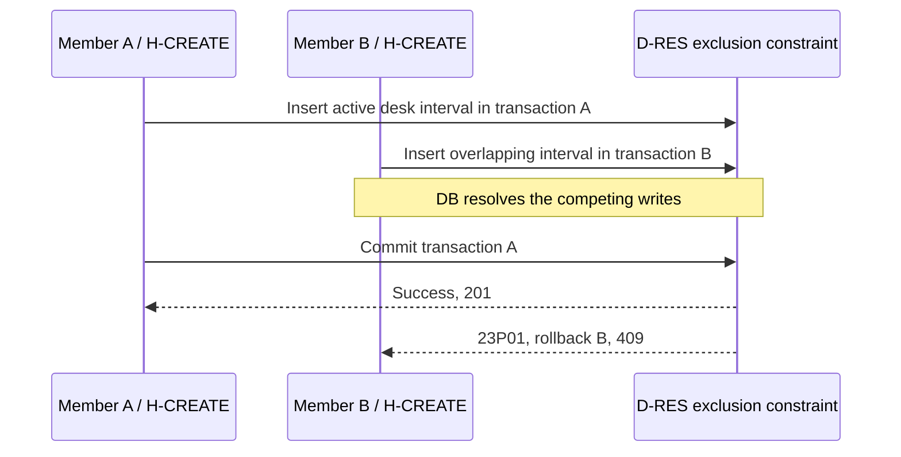

DG-RACE · one possible ordering, not a preference for A. Either member can win;
AC-04 asserts one success, one conflict, one active row and one CREATE audit.
If the first writer rolls back, the other may succeed instead. Two cancellations
serialize on the reservation lock; only the first writes a CANCEL audit.

## 12. External integrations and jobs — S12 omitted

No provider, queue or background job is needed for this release. DG-API and
DG-RACE already show the consequential effect ordering. Adding notifications
later requires a feature delta specifying durable delivery and failure behavior.

## 13. Startup, deployment and recovery — S13

Generate a root `compose.yaml` with `db`, `api` and `web`. DB is PostgreSQL16 with
a named data volume and no published port. API is one uvicorn worker on private
port8000. Web builds the SPA using Node22/pnpm and serves it with Caddy2 on
`127.0.0.1:8080`. Route `/api/*` to API preserving `/api`; other paths serve the
SPA with `index.html` fallback. The FastAPI router owns the `/api` prefix.

| Config | Required/default | Contract |
|---|---|---|
| POSTGRES_DB/POSTGRES_USER | `deskslot` / `deskslot` | database initialization |
| POSTGRES_PASSWORD | required secret | `.env` and DB/API only, never frontend |
| DATABASE_URL | required API secret | SQLAlchemy psycopg DSN to private db:5432 |
| BASE_ORIGIN | `http://localhost:8080` for local | exact write Origin; production HTTPS origin must be configured |
| COOKIE_SECURE | true; false only for explicit loopback dev | bootstrap rejects false for a non-loopback BASE_ORIGIN |
| SEED_PASSWORD | required only during seed/test | seed accounts; not a running frontend setting |

Local procedure after generated implementation:

```bash
docker compose up -d db
docker compose run --rm api alembic upgrade head
docker compose run --rm api python -m app.seed
docker compose up --build api web
```

Seed is idempotent: create member1/member2 with fixed UUIDs and emails
`member1@example.test` / `member2@example.test`, names Member One/Two, plus desks
D01–D03. Desk D01 has UUID `20000000-0000-4000-8000-000000000001`; increment the
last digit for D02/D03. Member UUIDs similarly begin `10000000` and end1/2.
Seed uses SEED_PASSWORD for newly created users and never resets existing passwords.

The API image installs locked dependencies and includes the `app` package and
Alembic config. Web `package.json` defines `dev` as `vite`, `build` as `tsc -b &&
vite build`, and `test` as `vitest run`; a committed pnpm lockfile makes installation
reproducible. Backend lock includes FastAPI/Pydantic/SQLAlchemy/Alembic/psycopg/
argon2-cffi and test dependencies pytest/httpx. Pin the resolved container/library
patches during implementation rather than using floating latest in production.

OP-HEALTH checks DB with a bounded 2-second timeout, returning200 or503; implement
H-HEALTH in `api/app/main.py`. API starts after DB health but does not silently run
schema migrations on every request. Log structured request ID, route, status and
latency. Do not log raw bodies, cookies, passwords or database URLs.

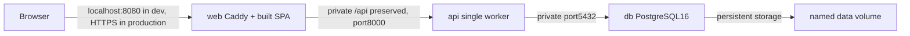

DG-DEPLOYMENT · deployment adaptation. Bind nodes to compose services and config;
production ingress requires configured TLS/origin and Secure cookies. No DB/API
port is published directly in the defined deployment.

Backup: operator runs `docker compose exec -T db pg_dump -U deskslot -d deskslot
-Fc > backup.dump`. Restore rehearsal uses a separate empty database/volume,
matching migrations and `pg_restore --clean --if-exists`; never silently restore
over the active office DB. Verify member/desk/reservation/audit counts and the
overlap constraint on restored data. Before an incompatible migration retain a
verified backup; prefer forward repair, or explicitly plan downtime/restore with
the operator. Application restore has not been executed for this worked example.

## 14. Acceptance and tests — S14

Implement backend checks in `api/tests/` using a real PostgreSQL16 test database
with migrated schema, isolated fixtures and an injected clock. UI tests live in
`web/src/__tests__/`; browser flows in `tests/e2e/` using Playwright. Do not substitute
SQLite for exclusion-constraint or lock tests.

| AC ID | Behavior/contracts | Fixture/action | Observable oracle |
|---|---|---|---|
| AC-01 | F-AUTH / SC-01 / H-AUTH/H-ME | active member; valid/invalid login, expired session, logout | valid login200, protected access works; invalid/expired/revoked access401; no hash/token in JSON |
| AC-02 | F-AVAIL / SC-02 / H-AVAIL | D01 active09:00–10:00, D02 free; request09:30–10:30 | D01 unavailable, D02 available; adjacent10:00–11:00 leaves D01 available |
| AC-03 | F-CREATE / SC-03 / H-CREATE | valid future interval on D02 | 201 + resolvable Location, exact owner/interval/status; one reservation and CREATE audit |
| AC-04 | R-OVERLAP / H-CREATE / D-RES | two concurrent HTTP requests, independent transactions, same desk/interval | one201, one409; one ACTIVE row and one CREATE audit; never two active overlaps |
| AC-05 | R-OWNER / SC-04 / H-MINE/H-GET | two members, each owns a reservation | lists/total contain only own rows; foreign GET returns404 without details |
| AC-06 | F-CANCEL / SC-05 / H-CANCEL | owner cancel/repeat, foreign member, begun interval, concurrent cancels | owner200 and slot freed; repeat200 unchanged; foreign404; begun409; one CANCEL audit |
| AC-07 | R-ACTIVE/R-ORIGIN / H-ME | inactive member, absent/mismatched Origin, sixth login attempt | protected403; writes403 with no changes; sixth attempt429 and valid Retry-After |
| AC-08 | R-TIME / OP-CREATE | naive/infinite timestamps, end<=start, >120minutes, off-boundary, past/>30day start, unknown write field | 422, no reservation/audit |
| AC-09 | UI-LOGIN/AVAIL/MINE | browser login, reserve, see own row, cancel; injected409 and transport failure | visible outcomes and recovery as section6; keyboard route works; stale availability cannot submit |
| AC-10 | D-RES/D-AUDIT / H-CREATE | inject audit insert failure before commit | transaction rolls back reservation; error response, no partial durable creation |
| AC-11 | C-OPS / D-RES | clean initialization and separate backup restore rehearsal | startup/health succeeds; restored rows/constraints match; overlap rejected on restored DB |

Every case currently has evidence `NOT_RUN`. Generate commands:
`docker compose run --rm api pytest tests`, `pnpm --dir web test`,
`pnpm exec playwright test tests/e2e`, `pnpm --dir web build`.
Root `package.json` owns Playwright and its dev dependency/lockfile; web owns
Vitest. Backend pytest exits nonzero on failed assertions and isolates/reset
fixtures without mutating a non-test database.

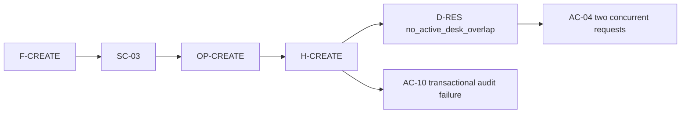

DG-ACCEPTANCE · trace adaptation. The cases above define their real oracles;
graph connectivity alone does not show that the application passes them.

## 15. Decisions and implementation context — S15

| DEC ID | Choice and reason | Consequence / revisit |
|---|---|---|
| DEC-DB | PostgreSQL range exclusion enforces desk overlap under concurrent writes | keep real-DB race tests; revisit if storage must change |
| DEC-STACK | small SPA + one Python API process | straightforward deployment; revisit limiter/session assumptions before scaling |
| DEC-TIME | UTC-only input/display in this demonstration | explicit label/conversion; localized office schedules need a feature delta |
| DEC-REPEAT | creation returns conflict on repeat; cancellation is idempotent | inspect own list after uncertain creation; add key-based replay only if product needs it |
| DEC-EFFECTS | no notifications/providers/jobs | avoid unnecessary delivery state; add contracts before introducing external effects |

### Worked authoring path: DEC-DB

This is an authored demonstration of the `DEVELOP` path for one decision, not a
record of an executed database experiment or a user-approved product choice.
S01 already supplies the booking outcome and scope. W01 is `OMIT`: the product
direction is clear. W02/W03/W04/W05 are `INCLUDE` for R-OVERLAP and its contracts.

**W02 research question:** how can PostgreSQL16 prevent overlapping ACTIVE
reservations when independent writers request the same desk? The
[range-constraint documentation](https://www.postgresql.org/docs/16/rangetypes.html#RANGETYPES-CONSTRAINT)
supports an exclusion constraint combining resource equality and range overlap.
[Row-lock documentation](https://www.postgresql.org/docs/16/explicit-locking.html#LOCKING-ROWS)
supports serializing transactions on a shared row. These are source-supported
mechanisms; their DeskSlot integration has not been executed. Sources inspected
2026-10-10. Performance and migration feasibility remain unmeasured.

**W03 alternatives:**

| Mechanism | Consequence under this scope | Decision |
|---|---|---|
| Query availability, then insert without a shared lock/constraint | Two writers can both observe availability before either commits; the check alone does not enforce R-OVERLAP | Reject as sole enforcement; keep availability as a UI snapshot |
| Lock the desk row, recheck overlap, then insert in the same transaction | Can serialize cooperating writers per desk; every write path must follow that locking protocol | Credible alternative if constraints cannot express the rule |
| `no_active_desk_overlap` exclusion constraint | Storage rejects the prohibited combination; H-CREATE maps that constraint violation to the specified409 | Proposed DEC-DB; fits the existing D-RES contract |

The concurrency analysis is our design inference from the documented mechanisms,
not a measured comparison. The DDL in section9 and algorithm in section8 own the
resulting contract; they are not repeated here.

**Bounded probe, NOT_RUN:** initialize migration0001 in an isolated PostgreSQL16
test DB with two active members and desk D02. Use independent connections to insert
the same valid future interval in concurrent transactions; hold the first insert
uncommitted until the second attempts its insert, then commit the first. Finish
both transactions and inspect constraint identity and durable rows. One commit
and one `no_active_desk_overlap` rejection support storage integration; two active
rows, an unexpected constraint or inability to install the migration falsify the
proposed integration. A hang beyond the test timeout is inconclusive and needs
lock/fixture investigation. Drop only the isolated test DB after inspection.

**W04 derived checks:** AC-04 observes the HTTP mapping and final reservation/audit
state; a storage-level probe alone cannot prove those API guarantees. AC-02 covers
adjacent intervals, AC-06 cancellation, and AC-10 transactional audit failure.
Use the actual PostgreSQL constraint and controllable test clock, not an in-memory
substitute. All cases remain NOT_RUN.

**W05 review:** the choice must agree with R-OVERLAP, OP-CREATE, H-CREATE, D-RES,
UI-AVAIL conflict recovery, DG-STATE and AC-04. Preserving non-overlap must not drop
the separate requirement that an audit and reservation change commit atomically.
The example remains READY_FOR_REVIEW; no application execution supports a stronger
integration or performance claim.

### Shared rules to retain during implementation

| Rule / scope | Incompatible implementation prevented | Owning contract / reconsideration |
|---|---|---|
| Enforce R-OVERLAP at storage; availability is informational | One writer treating a successful precheck as permission to commit an overlap | DEC-DB, D-RES, H-CREATE; revisit if storage changes |
| Commit create/cancel and their audit atomically | Booking succeeding while its audit fails, or duplicate cancellation audits | D-AUDIT, H-CREATE/H-CANCEL, AC-06/10; revisit before introducing external effects |
| Apply ownership on server-side reads and writes | Frontend filtering being mistaken for protection from another member's access | R-OWNER, H-MINE/H-GET/H-CANCEL, AC-05/06; revisit if sharing is added |

These rules are references to existing normative contracts, not a second schema
or new functionality. Current field/file/config detail belongs to implementation
sources as they are created. Always include the applicable rule and contract for
the slice being built; keep unrelated authoring policies out of its context.

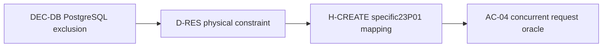

DG-DECISIONS · rationale/dependency adaptation. Its governing facts are DEC-DB,
the DDL and H-CREATE; this picture does not replace them.

During implementation load this spec's relevant section and actual contracts
in `api/app/contracts.py`, generated OpenAPI, migration0001, client contracts and
current tests. Those generated/current files own actual implementation facts.
If they conflict with intended behavior, decide whether code or spec must change
and update the affected projections. Keep learned repo practices concise and
scope them to the module where they apply; do not repeat this spec in instructions.

## 16. Quality targets — S18

These are proposed acceptance targets, not observed performance. Quality fixture:
30desks, 1000members and 5000reservations; a single API and PostgreSQL instance
with 2CPU/2GiB each. Availability load is 2requests/second from 10 authenticated
members for 60seconds after warmup. Target p95 server latency <=300ms and no5xx.
Generate a pytest performance case using HTTPX; record environment, sample count,
latencies and failures. The browser's full response latency is a separate measure.

UI acceptance requires keyboard completion of the main flow and labels/focus/
announcements from section6; color alone cannot communicate availability/status.
Health must report503 within the 2-second probe budget when DB is unavailable.
Integrity requires AC-04 and AC-10 regardless of latency. Deployment/restore
verification is AC-11. Every measurement is currently NOT_RUN.

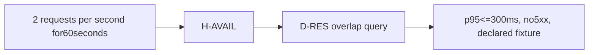

DG-QUALITY · critical-path adaptation. This identifies a proposed measurement
path; it is not an executed IDEF2 simulation or benchmark.

## Review evidence

The package author reviews this example for contract consistency and checks its
diagram sources separately. It remains a proposed design with no application
implementation, dependency-resolution run, database execution or model-generation
benchmark. Record concrete evidence when those activities are performed; do not
replace NOT_RUN with PASS merely because the document or a diagram was generated.
