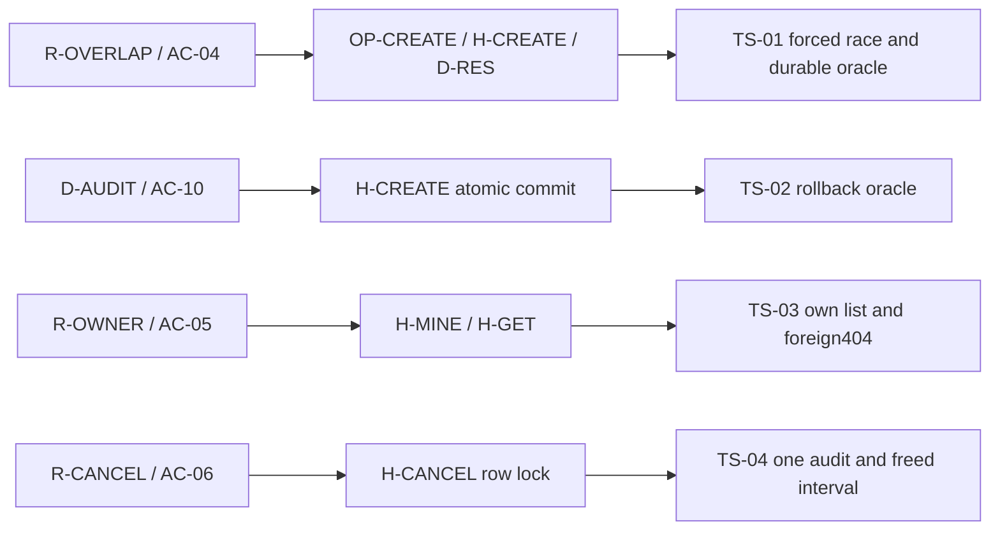

# DeskSlot — focused test specification

Version: 0.1 · View: TARGET · Status: DRAFT · Execution: NOT_RUN

Baseline: [DeskSlot SPEC v0.1](SPEC.md), AC-04, AC-05, AC-06, AC-10 and their enforcing
contracts. That baseline is an authored proposal, not owner-accepted behavior or
an implemented application. These are candidate checks demonstrating S14/W04.
The parent owns API, schema and rules; this document owns the test design only.
Future fixture paths below are outputs to create, not existing files.

## Scope and method selection

Detect double booking, partial create/audit commits, cross-member disclosure and
duplicate cancellation effects. This is focused backend integration coverage;
it does not replace the parent's other acceptance cases, UI flows or quality plan.
S01/S14 are included. Parent S07–S11 contracts supply inherited behavior.
S18 measurements are omitted here because this slice has no performance claim.

W04/W05 are included for case design and agreement with the parent. W01 is
omitted because the goal is understood; W02/W03 need reopening only if a test
assumption or testability seam cannot be supported. External QA skills requiring
accepted behavior are not invoked against this proposed baseline.

| Risk | Failure and consequence | Enforcement | Level / case |
|---|---|---|---|
| TR-OVERLAP | Both concurrent bookings succeed for one desk/interval | R-OVERLAP, H-CREATE, D-RES | Real API + PostgreSQL / TS-01 |
| TR-PARTIAL | A reservation survives a failed CREATE audit | H-CREATE transaction, D-AUDIT, AC-10 | Real API + PostgreSQL with failure injection / TS-02 |
| TR-OWNER | Another member reads a protected reservation or sees it in their list | R-OWNER, H-GET/H-MINE, AC-05 | Authenticated API + durable fixtures / TS-03 |
| TR-CANCEL | Concurrent owner cancellation duplicates effects or keeps the slot occupied | R-CANCEL, H-CANCEL row lock, D-AUDIT, AC-06 | Real API + PostgreSQL / TS-04 |

## Environment and named fixtures

- EF-DB: isolated PostgreSQL16 database initialized by migration
  `api/migrations/versions/0001_initial.py`, including `btree_gist` and
  `no_active_desk_overlap`. Require at least two simultaneous database connections.
  The fixture accepts only a database freshly created for this run; a configured
  ordinary application database is not a fallback.
- EF-CLOCK: the injected application clock returns `2030-01-03T08:00:00Z`.
  The common interval is `2030-01-03T09:00:00Z`–`2030-01-03T10:00:00Z`, satisfying
  the parent's R-TIME without depending on today's date.
- EF-ACTORS: active members A/B with valid Argon2id test credentials, separate
  session cookies obtained through OP-LOGIN, and matching BASE_ORIGIN on writes.
  IDs: A=`10000000-0000-4000-8000-000000000001`,
  B=`10000000-0000-4000-8000-000000000002`.
- EF-DESK: D02=`20000000-0000-4000-8000-000000000002`, initially empty. Supply
  complete valid parent-defined rows; clear reservations/audits/sessions between
  cases so one case cannot satisfy another's oracle.
- EF-RACE: two request workers, independent sessions/connections, and a barrier
  immediately before their first reservation INSERT. The test fixture pauses only
  at the persistence boundary after request/precondition checks, releases both
  when they arrive, and does not replace validation, locking or storage. This
  is a proposed fixture seam in `api/tests/conftest.py`; production has no barrier.
  Arrival/termination timeout is ten seconds, with worker and connection evidence.
- EF-AUDIT-FAIL: a scoped persistence failure on the attempted CREATE audit before
  commit. Keep the real reservation write and real rollback; do not mock the
  whole handler or return a manufactured error response. Reset the injection
  after this case even when it fails.

## Candidate cases

| Case | Parent contracts | Fixture/action | Observable oracle | Execution / status |
|---|---|---|---|---|
| TS-01 | AC-04, R-OVERLAP, OP-CREATE, H-CREATE, D-RES/D-AUDIT | EF-DB/CLOCK/ACTORS/DESK/RACE; A and B POST the same desk/interval through OP-CREATE | Exactly one201 and one409 RESERVATION_CONFLICT; winner is persisted with its actual owner; exactly one ACTIVE reservation and one matching CREATE audit | EX-BACKEND / NOT_RUN |
| TS-02 | AC-10, OP-CREATE, H-CREATE, D-RES/D-AUDIT | Reset fixtures; A submits a valid booking with EF-AUDIT-FAIL active | 500 INTERNAL_ERROR with request_id; after the response neither the attempted reservation nor its audit is durable | EX-BACKEND / NOT_RUN |
| TS-03 | AC-05, R-OWNER, OP-MINE, OP-GET, H-MINE, H-GET | Give A/B one valid non-overlapping owned reservation each; A lists and reads B's ID; then reverse actors | Lists and totals expose only the caller's row; foreign GET is404 RESERVATION_NOT_FOUND with no reservation payload; rows/audits remain unchanged | EX-BACKEND / NOT_RUN |
| TS-04 | AC-06, R-CANCEL, R-OVERLAP, OP-CANCEL, OP-CREATE, H-CANCEL, D-RES, D-AUDIT | A owns a future reservation; send two owner cancels on independent connections, then B books that same interval | Both cancels200 with the same cancelled_at; exactly one CANCEL audit; original row CANCELLED; B's booking201 confirms the interval is freed | EX-BACKEND / NOT_RUN |

For TS-01, verify both workers reached the barrier before either INSERT was
released. Otherwise the run cannot establish forced overlap and is inconclusive.
Query durable state through a fresh connection after both responses finish. A
serial precheck test or two mocked successful repository calls is insufficient.

For TS-02, identify the attempted reservation ID through the failure seam and
verify rollback through a fresh connection. A500 alone cannot detect a partial
commit. The parent already specifies INTERNAL_ERROR for unexpected failures.

For TS-03, normalize only protocol-defined ordering; do not mask extra rows or
fields before comparison. Record each response and the unchanged durable rows.

For TS-04, coordinate both workers before entry to the row-lock query, not after
one has acquired its lock. Both must enter the handler before the first completes.
The fixture records those entries; it cannot bypass FOR UPDATE or change its
ordering. Compare returned reservation fields and the persisted cancelled_at.

DG-TEST-DESIGN · TARGET · traceability adaptation. Rule/AC/operation/handler/data
nodes bind to the parent v0.1; TS nodes bind to this case table. The diagram shows
how each material failure reaches a falsifiable check. It does not show passing
execution or complete coverage of every parent acceptance case.

## Execution, evidence and cleanup

EX-BACKEND is the parent's planned `docker compose run --rm api pytest tests`,
after generation of its application, migrations and isolated fixtures. Place
these cases in `api/tests/test_reservation_integrity.py`. That command is not
runnable in this specification-only package and was not executed.

For each case preserve parent revision, case ID, dependency versions, fixture
identity, request/response status and bodies, request IDs, barrier/failure records
where applicable, durable row assertions and test exit result in the runner's
run-specific artifact directory. Credentials, cookie values and database secrets
are excluded from evidence. Protocol/data assertions are mechanical; these cases
need no semantic judge.

A satisfied oracle is PASS; a reproduced contradictory outcome is FAIL. Failure
to establish a required fixture, arrival barrier or completion within the bound
is inconclusive and needs diagnosis; it is not proof of a business-contract defect
or a passing case. Preserve the observed hang/error as evidence.

Always release waiting workers, remove scoped observers/failure hooks, close
connections and remove only the database created for this run. Verify its exact
run identity before removal. Do not clear a shared database to obtain isolation.

Design was inspected against the named parent contracts. Application execution
remains NOT_RUN; parent acceptance and the future fixture implementation remain
required before these candidate checks become an accepted executable test design.
