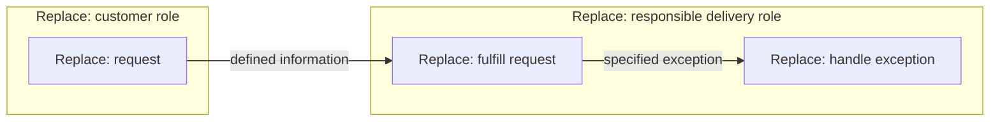

# {{company}} — operating specification

Version: {{version}} · Status: {{readiness}} · View: {{CURRENT_or_TARGET}}

## Purpose, customers and offerings — S01/S04

{{purpose_segments_offerings_terms_scope_and_success}}

## Responsibilities and processes — S17/S03

Record each role's responsibility, trigger, needed information, output, handoff,
exception/escalation and outcome measure. Separate current and proposed operation.

DG-COMPANY · role handoff adaptation, not formal BPMN. Bind roles/actions/handoff
data to the responsibility records. Text equivalent: {{normal_and_exception_ownership}}.

## Acceptance and evidence — S14

{{process_results_measures_sources_and_actual_evidence}}

## Rules and decisions

{{applicable_S10_rules_choices_gaps_and_sources}}

Do not invent software modules or DB tables unless implementing software is
part of the requested company specification.
