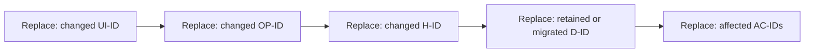

# {{feature}} — feature change specification

Baseline: {{exact_current_spec_code_version}} · Target: {{version}}
Status: {{readiness}} · Policies: {{selected_policy_ids}}

## Outcome and scenarios — S01/S03

{{user_outcome_trigger_conditions_normal_alternative_failure_and_recovery}}

## Contract delta — S16

| Contract ID | Current behavior | Target behavior | Added/changed/retained/removed | Consumers/acceptance |
|---|---|---|---|---|
| {{id}} | {{current}} | {{target}} | {{change}} | {{dependencies_cases}} |

Add the applicable frontend, API, handler, data, access and effects records from
the full application template. Describe actual fields and algorithms changed;
reference preserved contracts instead of duplicating them.

DG-DELTA · dependency impact adaptation. Annotate changed/retained/removed nodes
in text. Bind edges to actual consumers. Text equivalent: {{impact_and_compatibility}}.

## Compatibility, rollout and recovery

{{old_clients_data_migrations_feature_activation_rollback_or_forward_repair}}

## Acceptance and evidence — S14

{{regression_new_behavior_negative_cases_commands_and_NOT_RUN_checks}}

## Decisions and context

{{exact_affected_repository_practices_sources_assumptions_and_material_gaps}}
