# {{application_name}} — full application specification

Version: {{version}} · View: TARGET · Status: {{readiness}}

This is an editable template. Replace placeholders and sample diagram labels
with actual contracts. Omit inapplicable blocks with a reason or link a shared
diagram. Mermaid views are adaptations, not formal IDEF notation. Diagrams
supplement concrete records; they do not supply their missing fields.

## 1. Interview, outcome and scope — S01

Describe users, problem, useful outcome, readers, constraints, success measures,
inclusions, exclusions and material assumptions. Record selected policy IDs and
reasons, plus unresolved decisions with impact and next action.

Authoring path: {{DIRECT_or_DEVELOP_and_reason}}. If solution development is needed,
record the selected W policies and the decisions they resolve. Keep useful findings
in their owning sections; a separate research/plan document is optional.

| Actor ID | Actor | Goal | Access/responsibility |
|---|---|---|---|
| {{actor_id}} | {{actor}} | {{goal}} | {{scope}} |

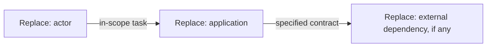

DG-SCOPE · TARGET · context adaptation. Bind nodes to actor/system records.
Text equivalent: {{boundary_and_external_responsibilities}}.

## 2. Function inventory and decomposition — S02

| Function ID | Parent | Function | Inputs | Outputs | Controls | Mechanisms | Scenario/contract IDs |
|---|---|---|---|---|---|---|---|
| {{function_id}} | {{parent_id}} | {{verb_object}} | {{typed_inputs}} | {{results}} | {{rules}} | {{resources}} | {{ids}} |

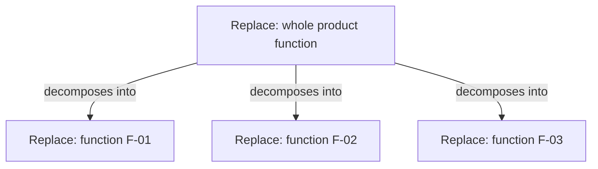

DG-FUNCTIONS · IDEF0-inspired hierarchy. Replace sample functions; edges mean
decomposition, not execution. Supply an ICOM view or formal IDEF0 when needed.
Text equivalent: {{function_coverage_and_leaf_contract_bindings}}.

## 3. Domain and information — S04

Define concepts, identity, relations, units/time zones and ownership. Specify
information sources, creators, readers, retention and derived versus authoritative
values. Define actual enum values where they govern behavior.

| Concept ID | Definition | Identity | Information source/owner | Relations |
|---|---|---|---|---|
| {{domain_id}} | {{meaning}} | {{identity}} | {{source_owner}} | {{relations}} |

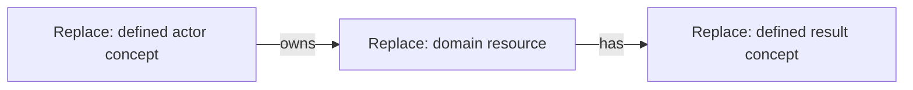

DG-DOMAIN · concept adaptation. Bind nodes and relation labels to definitions.
Text equivalent: {{domain_relationships}}. This is not the physical schema.

## 4. Scenarios and processes — S03

For each SC-ID specify actor/trigger, preconditions, numbered normal steps,
alternatives, failure/recovery, postconditions and acceptance IDs. Identify
the concrete operation or human responsibility for consequential steps.

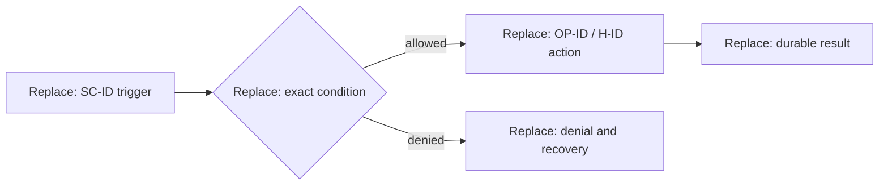

DG-PROCESS · IDEF3-inspired flow. Label conditions and branch/join semantics.
Text equivalent: {{normal_alternative_failure_recovery}}.

## 5. Architecture and module/file map — S05

Specify the stack, versions, deployment units, responsibilities and dependency
direction. Provide actual planned entrypoint/module paths for implementation.

| Component ID | Runtime/technology | Responsibility | Inputs/outputs | Owned data | Module/files |
|---|---|---|---|---|---|
| {{component_id}} | {{runtime}} | {{responsibility}} | {{contracts}} | {{data}} | {{paths}} |

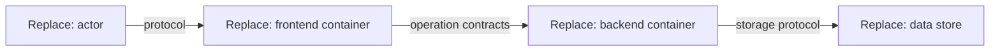

DG-ARCHITECTURE · C4 container adaptation. Replace components; keep context,
container and internal-component levels distinct. Bind edges to contracts.
Text equivalent: {{component_ownership_and_protocols}}.

## 6. Frontend screens, components and interaction — S06

For each UI-ID define route, actor/access, purpose, data/operation dependencies,
component composition and governing visual design. Specify form fields, labels,
types, validation, keyboard/focus behavior and navigation results. Define loading,
empty, error, success and permission states; give responsive and accessible layout.

| UI ID/route | Components/layout | Data dependency | Action → operation | Result/recovery | Acceptance |
|---|---|---|---|---|---|
| {{screen_id_route}} | {{components_design}} | {{contract}} | {{action_operation}} | {{states}} | {{acceptance}} |

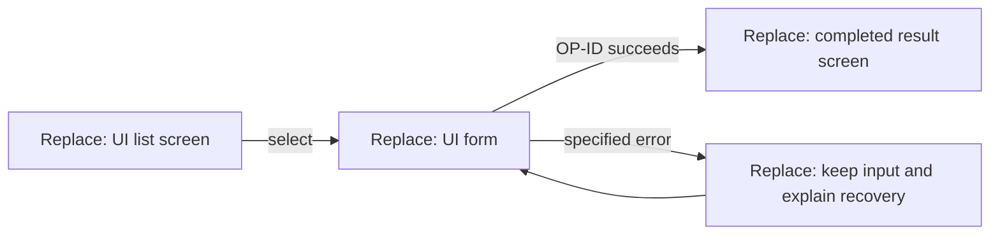

DG-INTERACTION · IDEF8-inspired action-response view. Bind transitions to UI/OP
records. Text equivalent: {{user_actions_feedback_and_recovery}}. Attach concrete
design/component rules; this diagram does not define visual layout.

## 7. API and protocol contracts — S07

For every OP-ID state method/path or message, caller, authorization, handler,
request schema, response schema/examples, status/error mapping, durable completion,
time conventions and repeat semantics. Define pagination/filtering if needed.

| Field | Type/format | Required/nullability | Validation/default | Ownership |
|---|---|---|---|---|
| {{field}} | {{type}} | {{presence}} | {{rule}} | {{client_or_server}} |

| Status/error | Condition | Response body | Caller recovery |
|---|---|---|---|
| {{status_code}} | {{condition}} | {{typed_body}} | {{recovery}} |

State which contract owns wire fields. Inline them here or link exact existing
OpenAPI operations; a proposed future filename is not an existing contract.

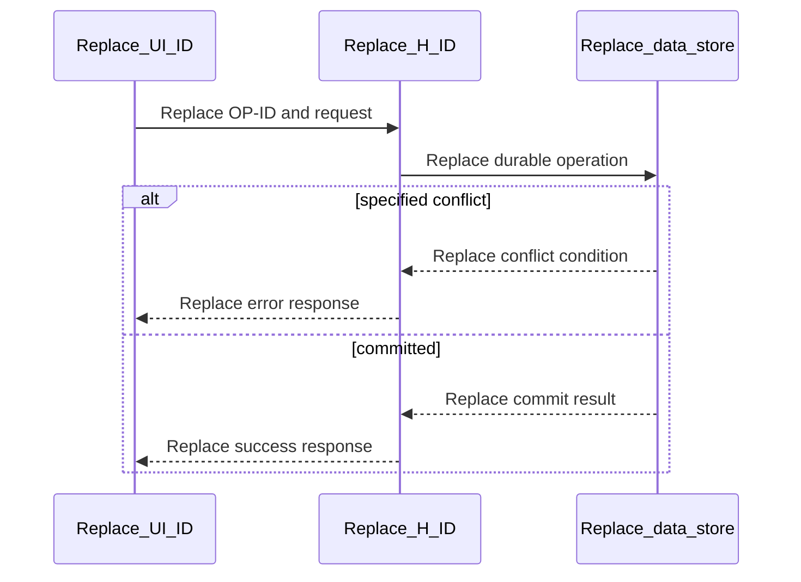

DG-API · boundary sequence. Text equivalent: {{call_auth_completion_error}}.
Bind participants/messages to UI/OP/H/data records.

## 8. Backend handlers and service algorithms — S08

For each H-ID supply actual planned path and signature, typed inputs/result,
dependencies, preconditions, ordered algorithm, validation, reads/writes,
transaction/lock boundaries, side effects and error mapping.

| Handler ID/path/signature | Dependencies | Algorithm | Transaction/locks | Effects | Errors/acceptance |
|---|---|---|---|---|---|
| {{handler}} | {{dependencies}} | {{ordered_steps}} | {{mechanism}} | {{effect_order}} | {{contracts}} |

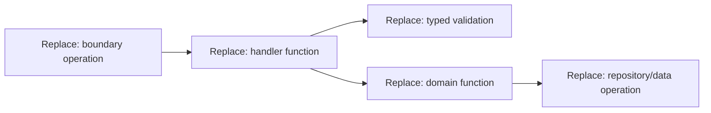

DG-HANDLERS · IDEF4-inspired call view. Text equivalent: {{calls_and_contracts}}.
Edges mean calls; use a process/sequence for actual order. Specify concrete
behavior, rather than a list of layer names.

## 9. Physical data schema and migrations — S09

Provide complete DDL/ORM definitions or exact owning contracts. Include field
types, nullability/defaults, PK/FK/unique/check/exclusion constraints, indexes,
deletion/retention, time representation and concurrency enforcement. Specify
representative queries, migration order, initialization and restore expectations.

```sql
-- Replace with complete, executable DDL for the selected database.
-- Define physical columns, keys, constraints and indexes here or in one owner.
```

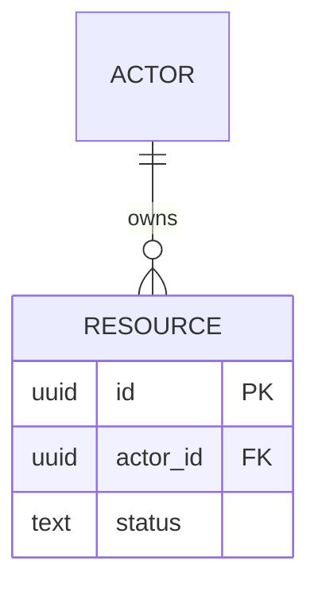

DG-DATA · ER adaptation, not formal IDEF1X. Replace types/entities/relations.
Text equivalent: {{schema_cardinality_and_constraints}}. Bind to D-ID/DDL.

## 10. Business rules, authentication and access — S10

| Rule ID | Context/condition | Allowed/denied result | API/handler/DB enforcement | Error/recovery | Acceptance |
|---|---|---|---|---|---|
| {{rule_id}} | {{condition}} | {{outcome}} | {{mechanism}} | {{error}} | {{acceptance}} |

Describe actual authentication/session and resource-scope rules. Define public
versus protected boundaries and sensitive data handling where applicable.

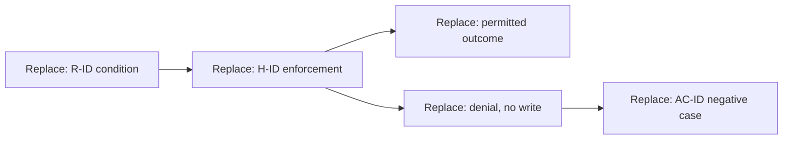

DG-RULES · enforcement adaptation. Text equivalent: {{checks_denial_and_oracles}}.
UI visibility does not replace server-side authorization.

## 11. Lifecycle, concurrency and effects — S11

| From → to | Operation/actor | Guard | Durable mechanism | Effect | Failure/repeat behavior | Acceptance |
|---|---|---|---|---|---|---|
| {{transition}} | {{operation}} | {{guard}} | {{transaction_constraint}} | {{effect}} | {{recovery}} | {{case}} |

Specify actual states, initial/terminal/deletion semantics and competing outcomes.
Use this sample only when a lifecycle exists; replace all invented states.

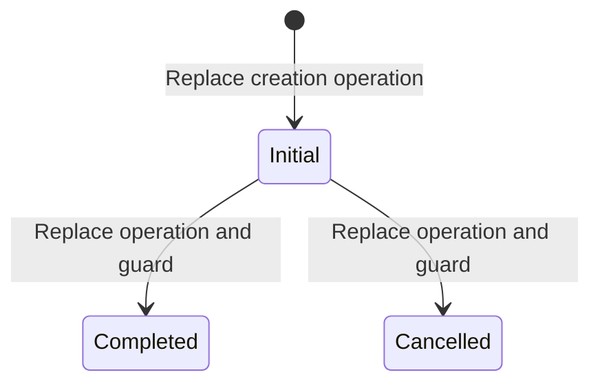

DG-STATE · state adaptation. Text equivalent: {{valid_and_denied_transitions}}.
For material races add a sequence showing competing callers and actual enforcement.

## 12. Integrations, events and background jobs — S12

Define trigger, parties, payload/schema/version, configuration, acknowledgement
versus completion, timeout, retry/backoff limit, deduplication, ordering, crash
recovery and observable failure. Omit if no external/background behavior is in scope.

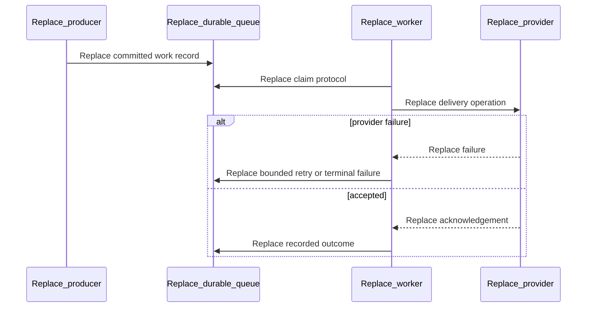

DG-INTEGRATION · delivery sequence. Text equivalent: {{repeat_and_failure_guarantees}}.
Bind messages and durability to actual job/provider contracts.

## 13. Setup, deployment and recovery — S13

Define prerequisites/versions; dependency, run, test and build commands; config
names/defaults/sensitivity; migrations and seed commands; deployment topology;
health/readiness, logs/metrics, backups, restore and rollout/recovery steps.

| Command or config | Exact value/interface | Purpose | Expected outcome |
|---|---|---|---|
| {{command_or_name}} | {{value}} | {{purpose}} | {{observable_result}} |

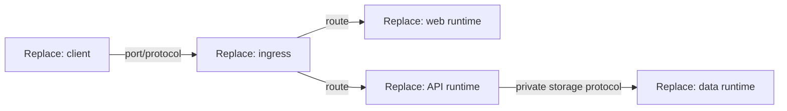

DG-DEPLOYMENT · topology adaptation. Text equivalent: {{processes_ports_config_and_ownership}}.
IDEF14's viewpoint is optional; provide actual operating contracts alongside it.

## 14. Acceptance and test specifications — S14

| AC ID | Function/scenario/contracts | Fixture/actor/environment | Action | Observable oracle | Command | Evidence |
|---|---|---|---|---|---|---|
| {{acceptance_id}} | {{ids}} | {{setup}} | {{action}} | {{expected_result}} | {{check}} | NOT_RUN |

Specify negative permission, integrity, concurrency, retry and failure cases where
those risks apply. Separate spec review from application test execution.
Use W04 when needed to choose test levels, deterministic fixtures, clock/network
control and real enforcing dependencies. A missing observable oracle is a design
gap. Define quality measurement fixtures and thresholds in S18 before execution.

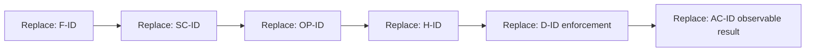

DG-ACCEPTANCE · trace view. Text equivalent: {{behavior_to_contract_to_oracle}}.
Graph connectivity does not establish semantic coverage or passing tests.

## 15. Decisions and implementation context — S15

| Decision ID | Choice | Reason/alternatives | Consequence | Revisit condition | Affected contracts |
|---|---|---|---|---|---|
| {{decision_id}} | {{choice}} | {{rationale}} | {{impact}} | {{condition}} | {{ids}} |

List exact repository sources and practices to read during implementation, with
scope and relevant rule. Code/schema/config own current facts. Do not copy a
volatile inventory into persistent instructions.

For shared architecture rules name scope, requirement, incompatible choices
prevented, owning contract and revisit condition. Greenfield file/schema/stack
detail seeds implementation; use actual code for current facts once it exists.
Research support and probe execution have separate statuses. Material untested
feasibility remains an explicit uncertainty, not a successful result.

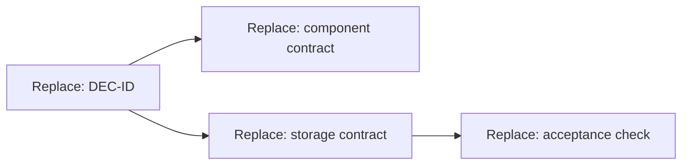

DG-DECISIONS · dependency adaptation. Reuse DG-ARCHITECTURE when sufficient.
Text equivalent: {{decision_consequences_and_context}}.

## 16. Quality targets and capacity — S18

Define each measurable target, workload/environment, measurement method, failure
threshold and evidence status. Include accessibility, reliability and recovery
targets as appropriate. Do not use an unmeasured number as demonstrated performance.

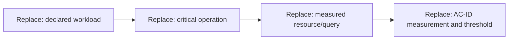

DG-QUALITY · critical-path adaptation. Text equivalent: {{load_resource_target_and_measurement}}.
Quantitative IDEF2 simulation is optional; a resource diagram alone is not simulation.

## Review evidence and open decisions

State actual syntax/render/semantic-review evidence and application checks.
Material unresolved decisions have impact and next action. Remove placeholders
before marking the resulting specification ready for review or implementation.
