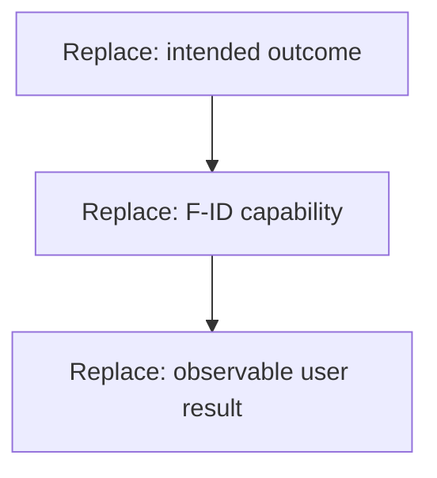

# {{product}} — product specification

Version: {{version}} · Status: {{readiness}} · View: {{CURRENT_or_TARGET}}

## Brief and scope — S01

{{users_problem_outcome_scope_exclusions_constraints_success}}

## Capabilities and domain — S02/S04

Define function IDs, input/result/rule/resource records and precise domain terms.
Distinguish evidence, hypotheses and selected behavior.

DG-PRODUCT · TARGET · capability adaptation. Bind nodes to the brief/functions.
Text equivalent: {{how_capabilities_produce_the_outcome}}.

## Scenarios — S03

For each scenario give actor, trigger, conditions, steps, alternatives, recovery
and result. Add a process diagram or reference a shared scenario diagram by ID.

## Acceptance — S14

{{requirements_scenarios_observable_acceptance_and_NOT_RUN_measurements}}

## Decisions and applicable technical blocks

{{selected_policies_sources_options_assumptions_gaps}}

A product brief is not automatically a complete application contract. Add
S05–S13/S18 only when technical scope is requested, or use FULL_APPLICATION.md.
