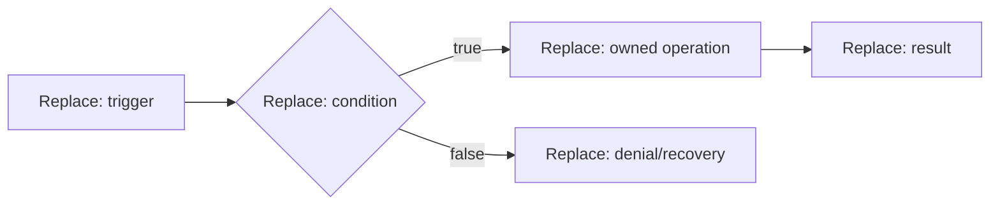

# {{scenario_id}} — {{scenario_name}}

Parent: {{exact_parent_spec_and_version}} · View: {{CURRENT_or_TARGET}}

## Outcome and conditions — S01/S03

Actor: {{actor}}. Trigger: {{trigger}}. Preconditions: {{conditions}}.
Goal/result: {{observable_outcome}}. Relevant rules/contracts: {{ids}}.

## Behavior

{{numbered_normal_steps_alternatives_failure_recovery_and_postconditions}}

DG-SCENARIO · process adaptation. Bind nodes/conditions to steps and contracts.
Text equivalent: {{normal_and_failure_behavior}}.

## Acceptance — S14

{{fixture_actions_expected_results_oracle_command_and_NOT_RUN_evidence}}

## Delta and gaps

{{assumptions_open_decisions_and_affected_parent_contracts}}

Reference owning technical contracts; define a delta only where this scenario
adds or changes behavior. Add a state view only for a material lifecycle.
