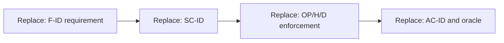

# {{subject}} — test specification

Behavior baseline: {{exact_owner_contract_ids_and_revision}}
Acceptance: {{accepted_or_proposed_and_actual_source}} · Status: {{readiness}}
Execution: NOT_RUN

## Scope — S01/S14

{{outcome_scope_material_risks_required_dependencies_and_exclusions}}

The parent owns behavior; this document owns cases, fixtures and evidence rules.
Reference exact parent contracts rather than copying another normative version.
If acceptance is unresolved, keep candidate checks visibly proposed.

## Risks and test levels

Use [spec-test-design](../../../spec-test-design/SKILL.md) to choose unit,
contract/integration, E2E, user simulation or a non-software observation by the
failure and enforcing boundary. No level is mandatory for every specification.

| Risk ID | Failure and consequence | Enforcing contract | Test level and reason | Covered cases / gap |
|---|---|---|---|---|
| {{risk_id}} | {{failure}} | {{contract_ids}} | {{level_observing_actual_mechanism}} | {{case_ids_or_gap}} |

Choose levels by the enforcing mechanism. Real storage is required for a storage
race; a mock cannot establish it. Non-software cases may use an observation,
rehearsal or experiment rather than a software test.

## Environment, fixtures and control

{{versions_setup_required_resources_isolation_and_existing_test_reuse}}

Define named fixtures, actors/access and deterministic data. Add clock/network
control, independent connections, coordination or failure injection only for cases
that need them. Specify what is reset between cases and the exact cleanup boundary.
Do not target production data or an unidentified environment.

## Cases

| Case ID | Behavior/scenario/contracts | Risk / level | Setup/fixture/actor | Action | Observable oracle | Execution ref | Evidence |
|---|---|---|---|---|---|---|---|
| {{case_id}} | {{ids}} | {{risk_and_level}} | {{setup}} | {{action}} | {{expected}} | {{execution_ref}} | NOT_RUN |

Each oracle must distinguish correct behavior from a plausible broken result.
Use separate case detail where a race, recovery or evidence sequence needs it.
Do not duplicate the same oracle at every level or add cases for a count target.

DG-TESTS · traceability adaptation. Bind all nodes to the declared baseline and cases.
Text equivalent: {{how_cases_observe_success_and_material_failures}}.

## Quality measurements — S18 when applicable

{{workload_environment_metric_threshold_sample_rule_and_required_evidence_or_omission_reason}}

Mark targets as proposed or accepted. A metric without a workload, measurement
method and threshold cannot provide an acceptance verdict.

## Execution and interpretation

Campaign disposition: {{NOT_NEEDED_or_PLAN_or_UNRESOLVED_and_reason}}

If coordination needs a campaign, link its owning plan with member cases/variants,
environment/reset, dependencies, budgets, stop/recovery and evidence aggregation.
Follow W07 and the test-design skill's campaign handoff guide. A portable candidate
plan does not substitute for native QA/simulation artifacts or authorize execution.

| Execution ref | Required setup | Exact command/action | Evidence produced | Current result |
|---|---|---|---|---|
| {{execution_ref}} | {{setup_refs}} | {{command_or_nonsoftware_action}} | {{evidence_location_and_fields}} | NOT_RUN |

{{cleanup_expected_failures_timeout_interpretation_and_actual_results}}

For meaning-dependent oracles define the judge input, typed judgment and explicit
uncertainty; mechanical scripts do not infer semantic quality from narrative.
Do not invent accepted product behavior merely to fill a test case.

Keep design review distinct from application execution. Preserve existing tests
unless their behavior is intentionally changed or their redundancy is demonstrated.
If a configured QA skill is used, preserve its native contract; this prose template
does not replace a canonical cross-plugin artifact.
