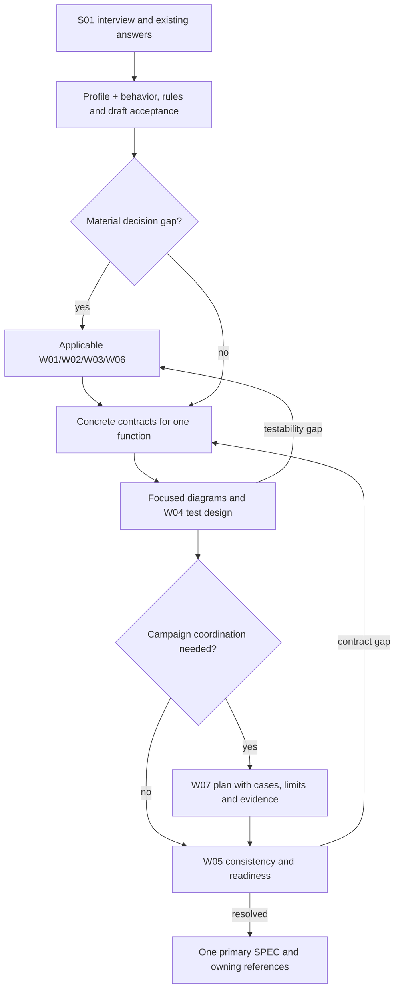

# Develop a specification by the decisions it needs

S01–S18 define content; W01–W07 define how decisions and checks are developed.
The template is an output shape, not a fixed execution sequence. Keep results in
their owning sections of one SPEC. A selected W method does not mandate a new
document, runtime, agent or approval.

## Order

1. S01 interview and reuse current source/answers.
2. Select the profile and S blocks; draft functions, scenarios, domain/access
   rules and candidate acceptance before committing to technical structure.
3. Resolve the actual gaps using W01 ideas, W02 evidence and W03 solutions.
   Apply W06 when an interaction/design decision needs its specialist method.
4. Refine each function across applicable UI/API/handler/data/state/effects.
   Build focused diagram projections and W04 cases alongside those contracts.
   A testability gap returns just that decision to solution design.
5. Specify applicable quality and operating requirements. Use W07 only if a
   coordinated test/simulation campaign needs an explicit plan.
6. W05 checks preserved source requirements, agreement, gaps and readiness.

These are dependencies. Reuse resolved work; independent blocks may proceed while
one question is pending. `DIRECT` composes a known solution and still uses the
needed tests/review. `DEVELOP` resolves material unknowns. `UNRESOLVED` names the
blocking owner intent or conflict without inventing an answer.

Emit `path`, `reason`, `stages[]` with `policy_id`,
`disposition: INCLUDE | OMIT | UNRESOLVED`, `reason`, `affects[]`, and
`uncertainty[]`. LLM interpretation selects meaning; code checks the declared
format. Invalid structured decisions need bounded repair or an unresolved result.
There is no keyword fallback or automatic dispatch from a policy selection.

## Methods and ownership

| Method | Decision | Result / owner |
|---|---|---|
| [W01 ideas](development-policies/W01-idea-space.md) | Useful alternatives are missing | Mechanisms and chosen direction → S01/S02/S03 |
| [W02 research](development-policies/W02-research.md) | Evidence, compatibility or pattern claims are uncertain | Cited claims, conflicts and implications → affected contract / S15 |
| [W03 solution](development-policies/W03-solution.md) | Credible alternatives need resolution | Choice and consequences → affected contracts / S15 |
| [W04 test design](development-policies/W04-test-design.md) | Behavior needs a fixture and falsifiable oracle | Focused test-design skill → S14/S18 |
| [W05 consistency](development-policies/W05-consistency.md) | Source requirements and contracts must agree | Findings, repairs and readiness → existing sections |
| [W06 design](development-policies/W06-design.md) | Interaction, layout, design rules or a scoped design check need work | Design-owned result → S06 and exact design references |
| [W07 campaigns](development-policies/W07-campaigns.md) | Cases/variants/contours need coordinated planning | Conditional plan → S14 / linked test-design owner |

Use [profile coverage](profile-coverage.md) to avoid assuming non-software subjects
need architecture. [Bindings](policy-bindings.md) select optional external methods
without copying their implementations or weakening their native requirements.

DG-AUTHORING · workflow adaptation. Its owner is this method contract; nodes
reference the methods above. Text equivalent: interview precedes behavior;
unresolved decisions invoke only applicable methods; diagrams and tests refine
each function; a campaign plan is conditional; review repairs affected contracts.
Syntax/render checks: NOT_RUN. This view makes no product execution claim.

Implementation loads the affected spec slice and real repository practices.
It does not replay interview/research history. No comparative model qualification
or operational world-model implementation is part of this authoring workflow.
