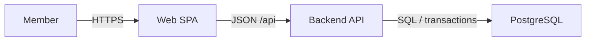

# Architecture, trust, deployment and capacity

Use the [C4 model](https://c4model.com/diagrams) for software ownership views:
context shows people and external systems; containers show separately runnable
applications/data stores; components show responsibilities inside one container.
Keep levels explicit. A C4 container is not necessarily a Docker container.

Mermaid flowcharts can express C4 concepts if clearly captioned as adaptations.
Give components purpose and technology, and label edges with relationship and
protocol. Map nodes to concrete component/module records and edges to contracts.
Add component detail only for a material boundary question.

## Trust dataflow

For sensitive or protected operations, draw entrypoints, data stores and trust
boundaries; label the data and the authorizing check. A direction of dataflow
does not mean an allowed call or successful authorization. Bind every protected
edge to a rule and actual enforcement location. Record denial and data exposure.

## Deployment and IDEF14

IDEF14 supplies a network-design viewpoint. Adapt it only when network topology
matters. Specify actual runtime processes, ports, protocols, ingress, private data
stores and deployment/health/config ownership. A topology picture does not itself
provide container files, environment values or migration commands. See the
[IICE network chapter](https://www.idef.com/wp-content/uploads/2016/02/compendium.pdf#page=98).

## Capacity and IDEF2

IDEF2 addresses time-varying resources and simulation. Use a queue/resource view
for a concrete load question: workload, arrival/service rates, capacities,
measurement assumptions and bottleneck consequences. A drawn queue is an authored
model, not a benchmark. Link it to a defined measurement or simulation case and
state `NOT_RUN` until executed. See the
[family description](https://www.idef.com/wp-content/uploads/2022/08/IDEF1MR.pdf).

For a simple app reuse its deployment diagram to identify the capacity path
rather than inventing a second simulation workflow.
