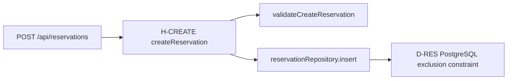
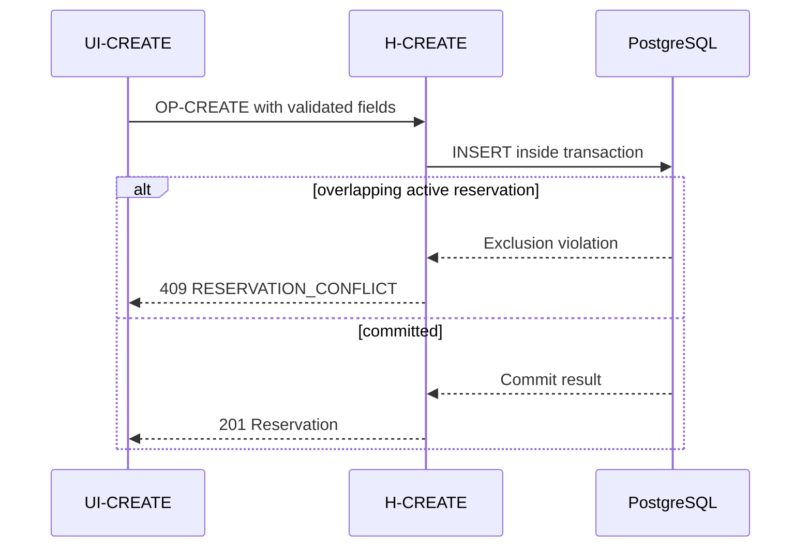

# API, handlers and IDEF4 contracts

IDEF4 includes method argument/result protocols, call dependencies, invariants
and method-set contracts. We adapt those ideas to handlers, services and domain
functions; the stack does not need inheritance. See
[the method description](https://www.idef.com/idef4-object-oriented-design-method/).

## Contract record

An implementation operation needs actual input/result types, owning path,
preconditions, dependencies, algorithm, data reads/writes, commit boundary,
effects and error mapping. A class or dependency diagram adds relationships;
it does not supply the whole record. Use class diagrams only for real classes.
For functional code a labeled call graph is often clearer.

Bind those nodes to paths and declared signatures. Edges mean calls/dependencies,
not automatic runtime ordering. Use a sequence for chronological behavior.

## Boundary sequence

Use exact operation IDs and messages. Show transaction start/commit where it
changes semantics, meaningful alternatives and external effects after commit.
An HTTP acknowledgement may precede job completion; label that difference.

For jobs show enqueue/delivery, retry owner, limit and crash recovery. Avoid
equating an at-least-once message with exactly-once provider behavior. Check
normal flow and failure against the handler, data and integration contracts.
Read [sequence syntax](https://mermaid.js.org/syntax/sequenceDiagram.html) when editing.
