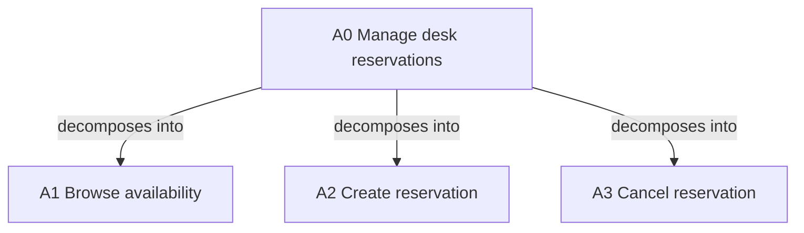

# Functions and IDEF0

Use for capability completeness and functional interfaces. IDEF0 describes
functions, not a chronological algorithm. Inputs enter left, controls top,
outputs leave right and mechanisms enter bottom. Use verb-object function names
and defined noun labels for arrows. Controls govern execution; mechanisms perform it.

## Formal view

Choose and cite the [historical FIPS 183 manual](https://nvlpubs.nist.gov/nistpubs/Legacy/FIPS/fipspub183.pdf).
The A-0 context diagram has one box representing A0, purpose and viewpoint.
The A0 diagram decomposes it into A1 onward; a diagram A1 details that particular
function into A11 onward. Non-context diagrams contain three to six boxes.
Preserve parent/child interfaces, node references and defined arrow meanings.
Review any tunneling against the manual. These notation rules do not prescribe
a quota of product features or interview questions.

The [SVG context example](../assets/idef0-context.svg) preserves directional ports.
It is a context fragment, not a complete decomposed IDEF0 model or a compliance
certificate. Supply child diagrams and their interface mapping when needed.

## Practical adaptation

Use Mermaid for a function hierarchy or explicit ICOM relationships when formal
notation adds little. Label it `IDEF0-inspired adaptation`; Mermaid layout does
not guarantee IDEF0 port placement. For example:

Bind A1–A3 to function records and their scenario, UI, operation, handler, data
and acceptance IDs. The diagram's edges mean decomposition; do not treat left
or top placement as runtime order. Specify actual execution using the
[process guide](process-state.md).

Check that all in-scope capabilities appear and that outputs have an actual
consumer/result. Avoid forcing every function into a single endpoint.
