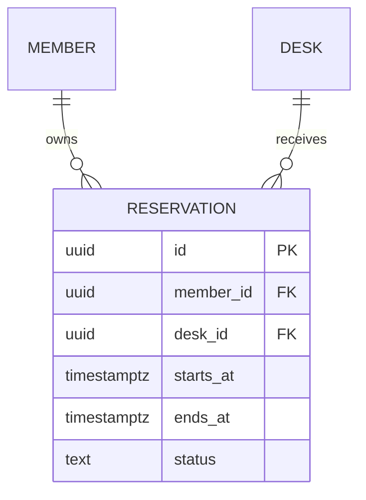

# Data and IDEF1X

IDEF1X supports logical relational design: entities, attributes, keys,
cardinalities and identifying dependencies. Use it after information needs and
the storage choice are established. An ontology concept need not be a table.
See [KBSI's description](https://www.idef.com/idef1x-data-modeling-method/) and
the [historical FIPS 184 manual](https://nvlpubs.nist.gov/nistpubs/Legacy/FIPS/fipspub184.pdf).

## Formal view

Use the manual's identifier-independent/dependent entity forms, primary-key
separation, relationship notation and cardinality conventions. An identifying
relationship propagates the parent's key into the dependent entity's primary
key. Distinguish this from an ordinary non-identifying foreign-key reference.
Review candidate keys, key minimality and relationship optionality.

The [identifying relationship SVG](../assets/idef1x-example.svg) is an authored
notation fragment. Its composite TASK key includes PROJECT's key. A full model
needs all relevant entities, relationships and supporting definitions; review
the chosen notation manually, rather than treating image rendering as compliance.

## Practical Mermaid ER

Use Mermaid ER as an accessible relational view and label it `ER adaptation`,
not formal IDEF1X. Read the selected renderer's
[ER syntax](https://mermaid.js.org/syntax/entityRelationshipDiagram.html).

This says each reservation has exactly one member and desk; each member/desk
can have zero or many reservations. Check that actual FKs and nullability agree.
Logical status/time constraints, indexes and overlap exclusion must be specified
in DDL or an equivalent owning contract; crow's-foot lines do not enforce them.

Bind entities/attributes to physical schema records. Include migration and
representative read/write queries. For nonrelational storage use an appropriate
document/key/access-pattern model with explicit consistency guarantees.
