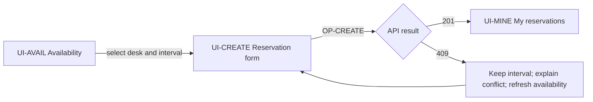

# Human interaction and company handoffs

IDEF8 focuses on user actions and system responses, including role-centered
scenarios and prototypes. It does not require concrete screen layout. We add
routes, components, fields, navigation, responsive states and accessibility to
make a frontend implementable. See the
[IICE interaction chapter](https://www.idef.com/wp-content/uploads/2016/02/compendium.pdf#page=123).

## UI adaptation

Draw a task's relevant screens and actions, with explicit feedback and recovery.
Bind screens to UI records and server actions to operation IDs. Distinguish
what the user sees from what the backend authorizes. A visual-only prototype
cannot establish data integrity or actual server completion.

The caption binds each route, message and recovery to its owning screen contract.
Provide an accepted design or concrete layout outside this flow; diagram boxes
do not define spacing, typography, components or keyboard behavior.

## Company adaptation

Use swimlanes/subgraphs for responsible roles and label handoffs with their
information/output. Define who owns an exception and what the next role needs.
Company responsibilities do not imply code modules or autonomous agent roles.

Mermaid swimlane-like subgraphs are ordinary flowcharts, not formal BPMN. If exact
BPMN semantics are requested, use a BPMN-capable authoring tool, retain its editable
source and review events, gateways, pools and message/sequence flows against the
[OMG specification](https://www.omg.org/spec/BPMN/2.0.2/). Do not label a generic
flowchart BPMN merely because it has lanes and diamonds.
