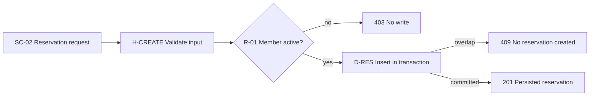
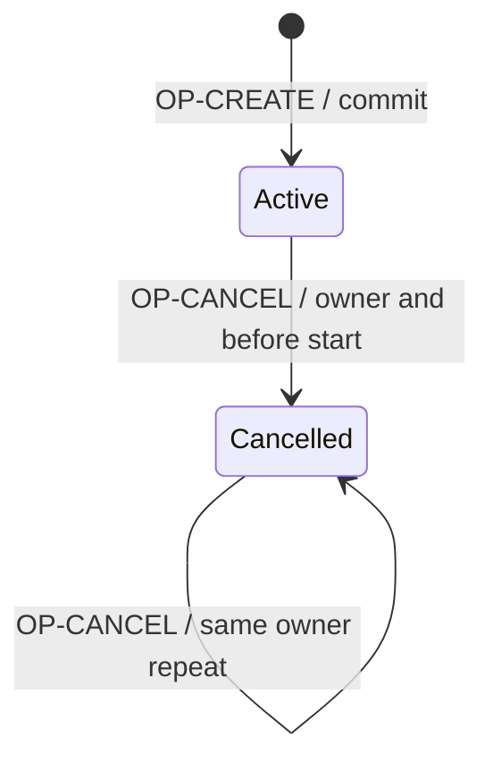

# Processes, state and IDEF3

IDEF3 has process-flow and object-state-transition viewpoints. Process diagrams
describe precedence and causality; state views describe allowable transitions.
Formal IDEF3 requires its UOB, link, junction and elaboration conventions; generic
diamonds and arrows are adaptations. See the
[method description](https://www.idef.com/idef3-process-description-capture-method/)
and [primary manual collection](https://www.idef.com/downloads/).

## Process adaptation

Give each action an owning scenario step or handler. Label conditions, joins,
loops, result and recovery. State whether branches are exclusive or parallel;
a diamond alone cannot distinguish an XOR choice from concurrent work.

Adjacent prose supplies the exact predicates and rollback behavior. This diagram
cannot replace the request schema or database exclusion constraint.

## State adaptation

Name a real domain lifecycle. Label edges with operation and guard, and bind
them to a transition table. Do not invent states solely because a state diagram
is available. UI loading state and domain reservation status are separate.

Specify terminal/deletion semantics in prose. Initial pseudostates are diagram
constructs, not stored enum values. Check failed guards and repetition explicitly.
For races add a sequence showing two callers, actual DB enforcement and the
winning/losing outcome; successful sequential tests do not prove concurrent integrity.

Read [state syntax](https://mermaid.js.org/syntax/stateDiagram.html) for the
selected Mermaid renderer. Syntax and state-contract review are separate evidence.
