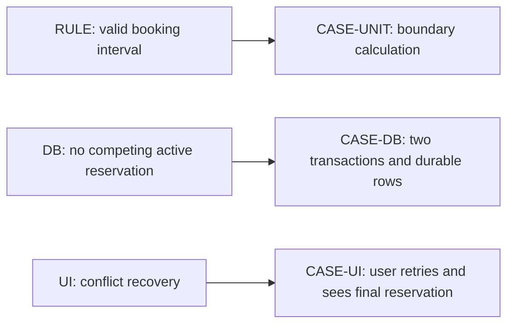

# Focused views for test design

Choose one reader question and one detail level. The test-design owner supplies
actual case IDs, risks, enforcing contracts and oracles; a diagram cannot infer
coverage or invent accepted behavior. Link rather than copy its normative table.

| Question | View and bindings |
|---|---|
| Which boundary can detect a rule's failure? | Behavior/risk → enforcing contract → selected test level → case/oracle |
| How is a race/retry reproduced and observed? | Sequence with independent connections, coordination, commit/ack and final observations |
| Which user journey/recovery is checked? | Action/state flow with actor, UI/operation IDs, failure branch and observable terminal outcome |
| How do cases/contours share reset or depend on evidence? | Campaign dependency flow with case IDs, environment/reset, join/stop points; omit when coordination is trivial |

Example adaptation for a declared booking rule (illustrative, not accepted product
behavior). The owner is this guide; CASE-UNIT/DB/UI and RULE/DB/UI refer to the
three distinct enforcement questions stated in the captions below.

DG-TEST-LEVELS · Mermaid adaptation. Text equivalent: the unit case observes the
interval rule, the database case observes competing writes, and the UI journey
observes recovery. These oracles cover different failures. Syntax/render and
semantic checks are NOT_RUN for this illustrative source.

For native simulation diagrams bind existing actor, brief, outcome, interface and
campaign records by exact reference. Do not redefine their world schema here.
Label planning versus execution and retain unresolved adapters/fixtures. Record
evidence using the [diagram evidence contract](diagram-evidence.schema.json).
