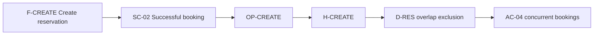

# Concepts, rules, traceability, rationale and change

IDEF5 contributes precise domain meanings and relations; IDEF6 contributes the
reason behind design decisions; IDEF9 contributes explicit business-rule discovery.
The following diagrams are our practical adaptations, not formal replacement
notations. See [sources.md](sources.md).

## Concept view

Draw a relationship map between defined domain concepts. Name what each edge
means, such as owns, schedules or requires. Keep the glossary authoritative and
do not assume every concept becomes a persistence entity.

## Rule and acceptance trace

Bind each rule to context/condition, enforcement, denial/conflict behavior and
observable acceptance. The same graph can expose missing enforcement or missing
tests. Its existence does not prove that the test oracle is sufficient.

Review the actual case: simultaneous overlapping requests must leave exactly
one active reservation and return the specified success/conflict outcomes.
Check both the positive and negative paths, not just connected arrows.

## Decision and impact view

For a material choice link decision → rationale → affected contracts → checks.
Alternatives remain options until selected. Keep the rationale concise, including
revisit conditions. A list of decisions or paths needs no decorative diagram.

For a feature change annotate each node `changed`, `retained` or `removed` in
text. Bind the baseline and intended delta, then trace callers, data compatibility,
migrations, recovery and tests. A dependency view and a before/after snapshot can
share IDs; neither authorizes implementation by itself.
